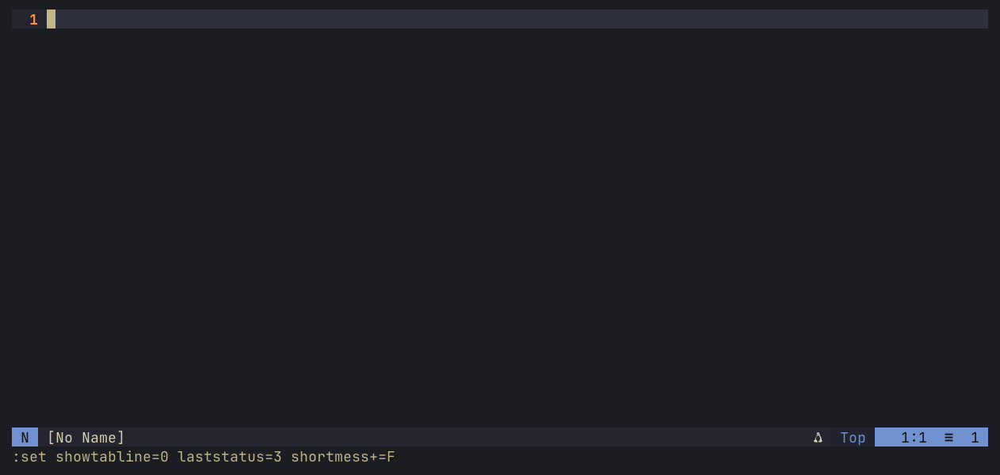
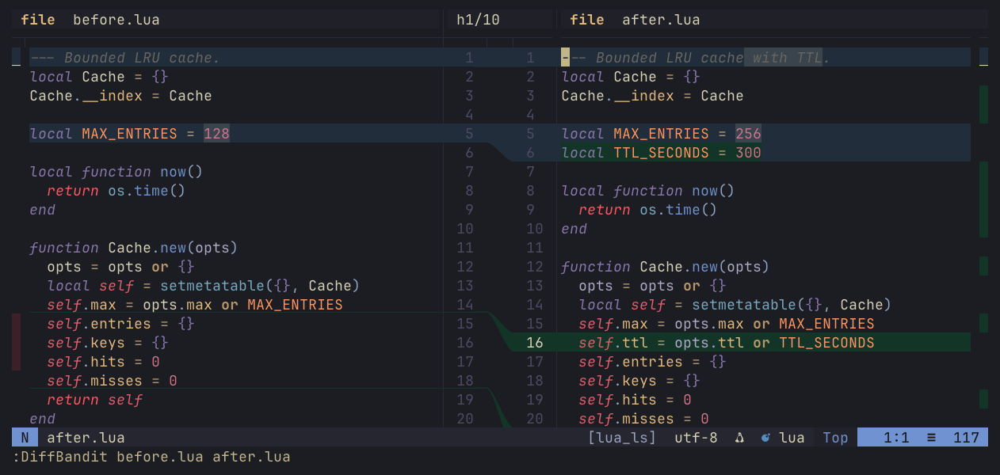
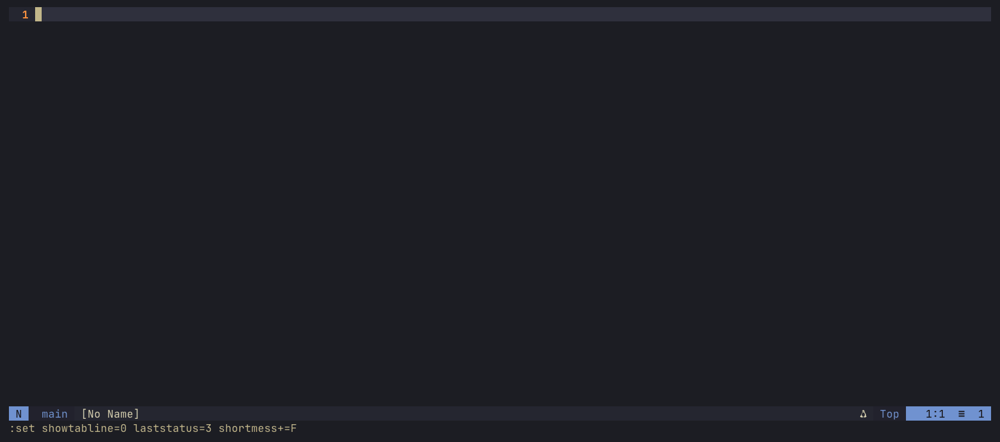
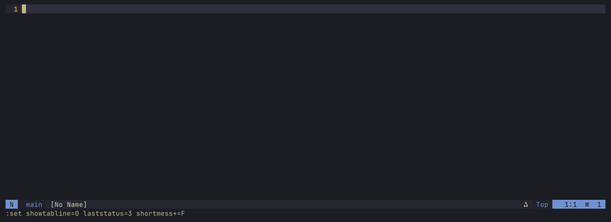
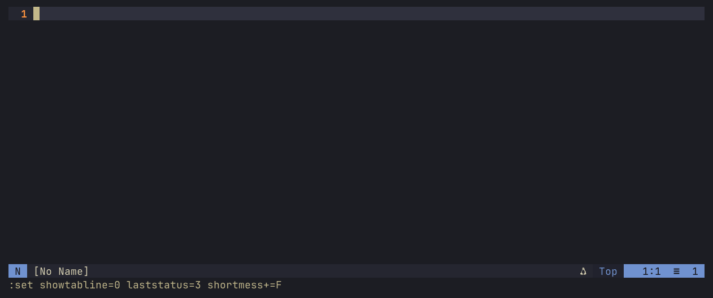

# diffbandit.nvim

[](https://github.com/CoreyKaylor/diffbandit.nvim/actions/workflows/ci.yml)

DiffBandit is a Neovim diff viewer built around a more natural comparison
model: the source document keeps its original shape and line numbers, the
destination document keeps its own shape and line numbers, and a compact
connector gutter draws the relationship between them.

Instead of inserting visual diff noise into either document or stretching rows
to force alignment, DiffBandit preserves each side as the editor would normally
show it. The middle gutter carries the explanation: additions, deletions,
changes, scroll-clipped regions, and merge relationships are routed between the
documents without distorting either one.

## Features

- Three-part diff layout with left content, connector gutter, and right content.
- Independent source scrolling with synchronized line-number panes.
- Native `'wrap'` (and virtual lines) in the source panes: line numbers, bands, and
  connectors follow wrapped rows, including `'smoothscroll'`.
- Connector routes for additions, deletions, changes, mixed hunks, and
  scroll-clipped regions.
- Smooth bezier connector ribbons in terminals that support the Kitty graphics
  protocol (Ghostty, Kitty, Rex, …), detected automatically with a fallback to
  the cell renderer everywhere else.
- Editable right-side target buffers for file, buffer, and Git worktree diffs,
  with normal Neovim writes, undo, syntax, LSP diagnostics, and completion.
- Read-only source panes keep filetype-driven syntax highlighting without
  showing source-side diagnostics.
- Git queue navigation for changed files with `]f` and `[f`.
- Read-only Git workflow review for branch comparisons, commit logs, commit
  changes, and guarded branch checkout.
- Hunk staging, unstaging, discard/apply actions, and undo.
- Optional Git commit panel with file staging, amend mode, commit message entry,
  and live diff preview.
- Merge conflict group in the commit panel with a local/result/remote resolver,
  editable result pane with editor integrations, gutter-guided accept actions,
  and resolve-on-write staging.
- Recursive folder comparison with efficient external digest checks and child
  file diffs that return to the folder view.
- One-column overview gutters that show changed regions proportionally across
  each document.
- Binary file support through a read-only hex comparison view.
- Theme-friendly semantic colors derived from the active colorscheme, with
  optional overrides.
- Plain Unicode defaults with optional Nerd Font-style icon overrides.

## Requirements

- Neovim 0.10 or newer.
- Git for `:DiffBanditGit`, `:DiffBanditGitCurrent`, hunk actions, and the
  commit panel.
- tmux only for the optional real-terminal smoke test.
- Nerd Fonts are optional.
- Image connectors need Neovim 0.12+ (`nvim_ui_send`), `termguicolors`, and a
  terminal with Kitty graphics + Unicode placeholder support. LuaJIT `ffi` and
  the system `libz` are used when present for speed and compression.

## Rendering

Connectors draw as smooth, anti-aliased bezier ribbons (modelled on IntelliJ's
diff divider) in terminals with the Kitty graphics protocol and Unicode
placeholders:

- Ghostty
- Kitty
- Rex
- anything based on libghostty

Detection is automatic (Neovim 0.12+), also inside tmux 3.3+ with
`allow-passthrough` enabled ([tmux](#tmux)). Everywhere else, including
iTerm2, Terminal.app, and Zellij, the cell renderer draws the same routes with
Unicode glyphs.
Details and options: [Image connectors](#image-connectors-kitty-graphics).

## Installation

With `lazy.nvim`:

```lua
{
  "CoreyKaylor/diffbandit.nvim",
  config = function()
    require("diffbandit").setup()
  end,
}
```

## Demo

Recorded in Ghostty, so connectors render as bezier ribbons (see
[Rendering](#rendering)).

<h3>Diff view and connector routes</h3>

Chunk navigation with `]c`, then scrolling one pane on its own: the ribbons
re-project against the moving viewport while the other document holds still.



<h3>The right pane is a real document</h3>

The destination side is an ordinary editable buffer with the language server
attached — completion, diagnostics, and undo all work, and the diff recomputes
underneath the edit.



<h3>Merge conflicts</h3>

Local, result, and remote side by side, each side reshaping the same code
differently. `]c` walks the changes; `>>`, `<<`, and `gb` take local, remote, or
both per conflict; `gA` applies the non-conflicting changes; `:w` resolves and
stages.



<h3>Commit panel</h3>

Changed files with a live diff preview, `<Space>` to stage, and a commit message
buffer that commits on write.



<h3>Folder diff</h3>

Compare two trees, walk the changed entries, and drill into a file diff that
returns to the tree on `q`.



## Quick Start

Compare two files:

```vim
:DiffBandit path/to/left path/to/right
```

Compare two loaded buffers by buffer number:

```vim
:DiffBanditBuffers 3 7
```

Compare two folders recursively:

```vim
:DiffBanditFolderDiff path/to/left-folder path/to/right-folder
```

Open the current repository's changed files:

```vim
:DiffBanditGit
```

Open the current file as a Git diff:

```vim
:DiffBanditGitCurrent
```

Toggle the Git commit panel:

```vim
:DiffBanditCommitPanel
```

Open Git workflow helpers:

```vim
:DiffBanditGitMenu
:DiffBanditGitLog --all --max-count 50
:DiffBanditGitCommit HEAD
:DiffBanditGitCompare main feature
:DiffBanditGitCheckout feature
```

Resolve a Git conflict:

```vim
:DiffBanditMerge path/to/conflicted-file
```

Close the DiffBandit view in the current tab (same as `q`):

```vim
:DiffBanditClose
```

## Editor Integration

DiffBandit uses real editable buffers for the right-side target in file,
buffer, and Git worktree diffs. Editing that pane behaves like editing the file
directly: insert-mode completion, LSP diagnostics, suggestions, syntax
highlighting, native undo, and `:w` all apply to the target buffer. When a
target file is already open elsewhere, DiffBandit reuses that buffer so edits
made in the diff view stay synchronized with the existing buffer.

Read-only source panes are syntax-aware but intentionally do not attach LSP
diagnostics. The left side of two-way diffs and the local/remote sides of merge
views keep their filetype and syntax highlighting, while warnings and
completion remain focused on the editable target/result pane.

## Git Modes

`:DiffBanditGit` accepts common diff scopes:

```vim
:DiffBanditGit                 " all changes, including staged and unstaged
:DiffBanditGit --staged        " staged changes only
:DiffBanditGit --cached        " alias for --staged
:DiffBanditGit --all           " staged and unstaged changes
:DiffBanditGit --current       " current file scope
:DiffBanditGit --base main     " compare against a base revision
:DiffBanditGit --rev main..HEAD
:DiffBanditGit --rev main...HEAD " against the merge base of main and HEAD
:DiffBanditGit --no-untracked
:DiffBanditGit -- -- pathspec
```

By default, Git diffs use `all` mode and include untracked files.

## Git Workflow Helpers

DiffBandit also exposes common review workflows:

```vim
:DiffBanditGitMenu                 " choose common Git actions
:DiffBanditGitLog                  " browse recent commits
:DiffBanditGitLog --all -- -- lua  " browse history scoped to a pathspec
:DiffBanditGitCommit HEAD          " review files changed by one commit
:DiffBanditGitCompare main feature " compare branches or refs
:DiffBanditGitCompare main feature --direct
:DiffBanditGitCheckout feature
```

Commit and branch review views are read-only Git queues. They reuse normal file
and hunk navigation (`]f`/`[f`, `]c`/`[c`) but disable staging, discard, apply,
and commit actions. Branch comparison defaults to a merge-base comparison; use
`--direct` for an exact ref-to-ref comparison.

## Standalone Launcher

`bin/diffbandit` opens DiffBandit for the repository in the current directory,
lazygit-style: one nvim with every changed file in the panel, where selecting a
file opens its diff. `q` quits, as does closing the last DiffBandit view.

```sh
ln -s /path/to/diffbandit.nvim/bin/diffbandit ~/.local/bin/diffbandit
ln -s /path/to/diffbandit.nvim/bin/diffbandit ~/.local/bin/git-diffbandit  # enables `git diffbandit`
```

Arguments follow `git diff`:

```sh
diffbandit                    # working tree changes, with the commit panel
diffbandit --cached           # staged changes
diffbandit main               # working tree compared with main
diffbandit main feature       # read-only review, also main..feature
diffbandit main...feature     # review against the merge base
diffbandit show HEAD          # review a single commit
diffbandit main -- lua/       # pathspecs, relative to the current directory
```

Subcommands:

```sh
diffbandit compare            # the whole branch, committed or not, against its merge base
                              # with the default branch (origin/HEAD, else main/master)
diffbandit compare develop    # ... against the merge base with develop
diffbandit compare --direct main   # against main itself
diffbandit compare --unpushed # only what the upstream does not have yet
diffbandit compare main feature    # read-only review, same as main...feature
diffbandit log -n 50 -- lua/  # commit log browser; Enter reviews a commit
diffbandit stash 1            # review stash@{1}
```

`compare` keeps the commit panel and the editable working tree. Hunk staging
there stages only the pending part of a hunk; committed changes cannot be
staged. A subcommand wins over a branch or path with the same name
(`diffbandit -- log` means the path). Closing a review opened from the log
returns to the log; `q` in the last open view quits.

The launcher starts nvim with your normal config, so diffbandit.nvim must be
installed there. It runs `:DiffBanditLaunch`, so a lazy-loaded plugin should
list that command among its load triggers. Set `DIFFBANDIT_NVIM_APPNAME` to use
a dedicated config (`NVIM_APPNAME`) or `DIFFBANDIT_NVIM` to pick the nvim
executable.

### External merge and diff tool

The same script can be called with file or folder paths, outside any
repository. This is how git and jj use it as an external tool:

```sh
diffbandit diff LEFT RIGHT     # read-only folder or file diff
diffbandit edit LEFT RIGHT     # editable folder/file diff: edit the right side in place
diffbandit merge BASE LEFT RIGHT OUTPUT [--path P]  # 3-way merge; :w resolves
```

A branch or path named `merge`, `edit`, or `diff` needs a leading `--`
(`diffbandit -- diff`). `merge` writes `OUTPUT` when you `:w` the result.
Quitting without resolving exits non-zero, so the conflict is kept. In `edit`,
you edit the right side through hunk apply actions or by hand, and `:w` saves
each file. `:cq` aborts the operation.

Git:

```sh
git config --global mergetool.diffbandit.cmd 'diffbandit merge "$BASE" "$LOCAL" "$REMOTE" "$MERGED" --path "$MERGED"'
git config --global mergetool.diffbandit.trustExitCode true
git config --global difftool.diffbandit.cmd 'diffbandit diff "$LOCAL" "$REMOTE"'
```

jj (`~/.config/jj/config.toml`), for `jj resolve`, `jj split`, `jj squash -i`:

```toml
[merge-tools.diffbandit]
program = "diffbandit"   # bin/diffbandit on PATH
merge-args = ["merge", "$base", "$left", "$right", "$output", "--path", "$path"]
edit-args = ["edit", "$left", "$right"]
diff-args = ["diff", "$left", "$right"]
merge-tool-edits-conflict-markers = false

[ui]
merge-editor = "diffbandit"
diff-editor = "diffbandit"
```

## Default Keys

Press `g?` in any DiffBandit window to see its keys. The list comes from
the window's live mappings, so it reflects your remaps, and it explains the
compact diff header and the panel's staged symbols. Headers show a `g? help`
hint; set `navigation.help_key = false` to turn both off. Every mapping also
has a `DiffBandit: ...` description, so which-key and `:map` list them.

Inside a diff view:

| Key | Action |
| --- | --- |
| `]c` | Next hunk |
| `[c` | Previous hunk |
| `]f` | Next changed file in a Git queue |
| `[f` | Previous changed file in a Git queue |
| `[d` | Align both panes to the top of the documents |
| `]d` | Align both panes to the bottom of the documents |
| `]s` | Snap the other pane to the cursor line |
| `C` | Open or focus the commit panel for the current Git file |
| `gzp` | Show or hide the commit panel |
| `<Space>` | Toggle stage for the active Git hunk (`actions.keys.toggle_stage`) |
| `>>` | Apply the left side to the right target |
| `<<` | Apply the right side to the left target |
| `u` | Undo the last DiffBandit hunk action |
| `q` | Close the diff session (`navigation.close_key`) |
| `g?` | Show the keys of the current window (`navigation.help_key`) |

At a file boundary, `]c` and `[c` first notify that the next press will move to
the next or previous file. This keeps hunk navigation deliberate while still
making multi-file Git review quick.

## Folder Diff

Open a read-only recursive folder comparison with:

```vim
:DiffBanditFolderDiff path/to/left path/to/right
```

DiffBandit scans both folder trees, aligns matching relative paths, and compares
same-size files with an external digest command such as `md5sum`, `md5`, or
`shasum`. File contents are not read into Lua during folder comparison; the
ordinary text or hex diff is loaded only when you open a file row.

Default folder keys:

| Key | Action |
| --- | --- |
| `<CR>` / `o` | Open the selected file pair, or toggle a directory |
| `]c` / `[c` | Next or previous visible difference |
| `<Space>` / `za` | Expand or collapse the selected directory |
| `zR` / `zM` | Expand or collapse all directories |
| `s` | Change the status filter |
| `R` | Refresh the folder comparison |
| `q` | Close the folder diff |

When a file row is opened, it appears as a child DiffBandit file diff. Pressing
`q` in that child diff returns to the original folder comparison with the row
selection restored.

## Commit Panel

Open the panel with `:DiffBanditCommitPanel`, or press `C` from a Git diff
opened by `:DiffBanditGit`.

| Key | Action |
| --- | --- |
| `j` / `k` | Move through changed files and preview the selected file |
| `<CR>` | Focus the diff for the selected file |
| `]c` / `[c` | Navigate hunks in the selected file preview |
| `<Space>` | Toggle staged state for the selected file |
| `a` | Open file actions for the selected file |
| `cc` | Focus the commit message window |
| `<Space>` in the commit message window | Toggle amend mode (`git.panel.keys.toggle_amend`; a key other than `<Space>` and the file stage key also works in the file list) |
| `:w` in the commit message window | Commit staged changes |
| `R` | Refresh the panel |
| `gzp` | Hide the panel, keeping the diff open |
| `q` | Close the whole view (diff, merge resolver, or standalone panel) |

`q` closes the view the same way from the panel and the diff panes, as does
`:DiffBanditClose`. An unfinished commit message is kept: closing the view
saves it for the repository, and the next commit panel opened there restores
it. Committing clears it.

Moving the panel selection between a merge conflict and a changed file swaps
the view in place, in the same tab.

The panel validates empty commit messages and missing staged changes before
committing, and rejects commits while merge conflicts remain unresolved. In
amend mode, the panel compares against the previous commit so the file state
reflects what the amended commit would contain.

File actions include staging, unstaging, discarding unstaged tracked changes,
restoring deleted tracked files, deleting untracked files, and adding useful
`.gitignore` patterns for untracked files.

## Merge Conflicts

Conflict files appear in a `Merge Conflicts` group above normal changes in the
commit panel. Selecting a conflict opens a three-pane resolver:

- left: local/current Git stage (`ours`), read-only
- center: editable result, initialized from the base stage
- right: remote/incoming Git stage (`theirs`), read-only

Default merge keys:

| Key | Action |
| --- | --- |
| `]c` / `[c` | Next or previous conflict |
| `>>` | Accept local/current into the result |
| `<<` | Accept remote/incoming into the result |
| `gb` | Accept both sides, local then remote |
| `gA` | Apply non-conflicting changes from both sides |
| `]s` | Snap the other two panes to the cursor line |
| `gzp` | Toggle the commit panel |
| `gzh` | Toggle the left (local) pane |
| `gzl` | Toggle the right (remote) pane |
| `gza` | Show all hidden panes and the panel |
| `:w` in the result pane | Write the result and mark the file resolved with `git add` |

Hiding panes gives the remaining panes the reclaimed width — useful for
focusing on the editable result when screen space is tight. The center result
pane is always visible.

DiffBandit warns when conflict stages have mixed line endings, but it does not
normalize them automatically.

## Hunk Actions

Git hunk actions operate on the active hunk in the right-side document pane:

- `<Space>` stages an unstaged hunk or unstages an already staged hunk in `all`
  mode.
- `>>` applies the left side of the hunk to the right target.
- `<<` applies the right side of the hunk to the left target.
- `u` undoes DiffBandit apply/stage actions in reverse order for the current
  file.

Staged hunks show an indicator next to the right-side line numbers. The default
symbols are plain Unicode squares so the UI remains usable without a patched
font.

## Binary Files

Binary files render as a read-only hex diff by default. Configure the hex view
with:

```lua
require("diffbandit").setup({
  ui = {
    hex = {
      enabled = true,
      bytes_per_row = 16,
      max_bytes = 65536,
      show_ascii = true,
      show_offsets = true,
    },
  },
})
```

Set `ui.hex.enabled = false` to show a compact binary-file notice instead.

## Configuration

Default setup:

```lua
require("diffbandit").setup()
```

Example with common customizations:

```lua
require("diffbandit").setup({
  diff = {
      ignore_whitespace = false,
  },
  navigation = {
    initial_focus = "right",
    align_on_jump = true,
    align_strategy = "change_top",
    document_keys = {
      top = "[d",
      bottom = "]d",
    },
    snap_key = "]s",
    close_key = "q",
    help_key = "g?",
  },
  git = {
    default_mode = "all",
    include_untracked = true,
    find_renames = true,
    file_keys = {
      next = "]f",
      prev = "[f",
    },
    panel = {
      width = 42,
      commit_height = 10,
      preview_on_cursor = true,
      keys = {
        toggle_stage = "<Space>",
        focus_diff = "<CR>",
        focus_panel = "C",
        focus_commit = "cc",
        file_actions = "a",
        toggle_amend = "<Space>",
        refresh = "R",
        close = "q",
      },
    },
  },
  merge = {
    result_initial_content = "base",
    auto_apply_non_conflicting = false,
    resolve_on_write = true,
    line_endings = {
      warn = true,
    },
    keys = {
      next_conflict = "]c",
      prev_conflict = "[c",
      accept_local = ">>",
      accept_remote = "<<",
      accept_both = "gb",
      apply_non_conflicting = "gA",
      focus_panel = "C",
      snap = "]s",
      toggle_panel = "gzp",
      toggle_local = "gzh",
      toggle_remote = "gzl",
      show_all = "gza",
      close = "q",
    },
  },
  folder = {
    gutter_width = 7,
    columns = {
      size = true,
      modified = true,
    },
    compare = {
      mode = "digest",
      backend = "auto",
      batch_size = 64,
      max_concurrency = 2,
      debounce_ms = 50,
    },
    filters = {
      include = {},
      exclude = {},
    },
    keys = {
      open = "<CR>",
      alternate_open = "o",
      toggle_expand = "<Space>",
      alternate_toggle_expand = "za",
      expand_all = "zR",
      collapse_all = "zM",
      next_diff = "]c",
      prev_diff = "[c",
      refresh = "R",
      filter = "s",
      close = "q",
    },
  },
  ui = {
    -- Connector core width. Defaults fix the gutter at 9 columns
    -- (min == max). Raise connector_max_width to allow once-per-document
    -- pressure expansion; set both equal for a different fixed width.
    connector_width = 9,
    connector_max_width = 9,
    scroll_debounce_ms = 16,
    -- "auto" | "kitty" | "cells" (see Image connectors below).
    connector_renderer = "auto",
    kitty = {
      transmission = "auto", -- "auto" | "file" | "direct"
      compress = true,
      probe_timeout_ms = 300,
      passthrough = "auto", -- "auto" | "tmux" | "none"
      tmux_terminals = nil, -- terminals trusted behind tmux (default Ghostty, Kitty)
      tmux_passthrough_all = true, -- see tmux below
      max_image_px = 4000000,
      cell_px = nil, -- { w, h } override; measured via the tty, else a 20x40 (HiDPI) estimate
      divider_width = 1.45, -- curve width in line heights (IntelliJ's 24px divider)
      insertion_line = { thickness = 1 / 18, offset = 1 / 18 }, -- matches the terminal underline
      image_colorspace = "auto", -- "srgb" | "display-p3" (auto: P3 for Ghostty on macOS)
    },
    split_blend = 0.3,
    overview = {
      enabled = true,
      width = 1,
      cursor = true,
    },
    status = {
      enabled = true,
      icons = "auto",
    },
    theme = {
      auto_refresh = true,
      background = nil, -- reference bg for blending when Normal has none (e.g. "#1e1e2e")
      transparent = nil, -- nil: detect from Normal; true/false forces see-through panes
      semantic_blend = 0.3,
      change_emphasis_strength = 0.16,
      min_background_delta = 0.08,
      colors = {
        add = nil,
        delete = nil,
        change = nil,
        change_emphasis = nil,
      },
      highlights = {},
    },
  },
  actions = {
    keys = {
      toggle_stage = "<Space>",
      apply_left = ">>",
      apply_right = "<<",
      undo = "u",
    },
    staged_indicator = {
      unstaged = "□",
      staged = "▣",
    },
  },
})
```

Theme colors are derived from the active colorscheme's diff highlight groups.
Use `ui.theme.colors` for semantic color overrides, or `ui.theme.highlights` to
override specific `DiffBandit*` highlight groups.

Transparent colorschemes (a `Normal` group with no background) keep the panes
and gutters see-through with no extra configuration: context rows, gutters,
splits, panels and status strips paint no background, while the
add/delete/change bands stay opaque. The bands are still blended against a
background color. Without one, DiffBandit picks a neutral dark or light color
based on `'background'`; set `ui.theme.background` (hex or a color name) to your
terminal's background to tune the bands to it exactly. `ui.theme.transparent = true` forces
see-through panes on an opaque theme, and `false` paints `ui.theme.background`
(or the fallback) instead.

### Image connectors (Kitty graphics)

With `ui.connector_renderer = "auto"` (the default), DiffBandit probes the
terminal for the [Kitty graphics protocol](https://sw.kovidgoyal.net/kitty/graphics-protocol/)
when a diff opens. It sends a capability query followed by a device-attributes
sentinel, so detection does not depend on terminal names (tmux is the
exception, see [tmux](#tmux)). When the terminal answers, each connector is drawn as an anti-aliased image of filled bezier
ribbons between the two panes, modelled on IntelliJ's diff divider. The curve
also replaces the wedge glyphs in the number-pane edge columns. Otherwise the
cell renderer is used, unchanged.

- The image is shown through Unicode placeholder cells in a small, static,
  non-focusable float laid over the gutter from one wedge column to the other.
  The float covers the window separators, so ribbons run unbroken from the
  number panes through the connector. Its text never changes while scrolling:
  only the image does. It follows splits and resizes and closes with its pane.
- The separators between each number pane and its document keep their line on
  context rows. On band rows they take the band color, and on an insertion
  point they carry the origin row's underline, so every band and insertion
  line runs unbroken from one document to the other.
- Sizing follows IntelliJ's side-by-side divider (24px beside a ~16.5px
  line, so about 1.45 line heights). The connector core shrinks to the fewest
  cells that hold a curve that wide. The band runs flat across the number-pane
  edge columns and curves only in the middle, using IntelliJ's control points
  (30%/70%) and 1px strokes. Insertion lines match the terminal underline
  they continue (`ui.kitty.insertion_line`, in line-height fractions). `ui.kitty.divider_width`
  (in line heights) makes it wider. Unlike IntelliJ, the active chunk keeps an
  outline.
- Ghostty on macOS shows image pixels as Display P3 but converts text colors
  from sRGB, so the same color would look more saturated in the curve than in
  the panes. `ui.kitty.image_colorspace = "auto"` converts the ribbon palette
  for Ghostty on macOS. Set `"srgb"` if your Ghostty uses
  `window-colorspace = display-p3`.
- The cell size is measured from the tty (or tmux). Without it (common over
  SSH), images use a 20x40 HiDPI estimate scaled down by the terminal. Set
  `ui.kitty.cell_px` to match your font exactly.
- Repaints ride the same debounced viewport path as the cell renderer. The rail
  solver is skipped entirely, and an image is re-sent only when the ribbon
  geometry, size, or theme changes.
- Images go through a temp file when the terminal can read one (local), and as
  zlib-compressed chunked data otherwise (SSH, remote multiplexers).
- `"kitty"` forces the image renderer and `"cells"` disables it. You can also
  set `vim.g.diffbandit_connector_renderer` or
  `DIFFBANDIT_CONNECTOR_RENDERER`.
- If the terminal rejects an image later, every open view falls back to cells.
- Zellij (0.45) has no Unicode placeholder support, so it uses the cell
  renderer. Ribbons will be detected once it adds them (zellij-org/zellij#5531).
- Neovim instances sharing one terminal (e.g. tmux panes) use separate image
  ids. Closing a view deletes only its own images.

#### tmux

Ribbons work inside tmux 3.3+ when the terminal running tmux supports them
(tested with Ghostty and tmux 3.8). Add this to `~/.tmux.conf`, then reload it
and reattach, because tmux applies `terminal-features` only when a client
attaches:

```tmux
set -g allow-passthrough on
set -as terminal-features ',xterm-ghostty:RGB'   # ',xterm-kitty:RGB' for Kitty
set -g focus-events on   # recommended: ribbons are re-sent when you return
```

- tmux does not pass the terminal's answer back, so detection asks tmux
  instead. Ghostty and Kitty are recognised; add other terminals with
  `ui.kitty.tmux_terminals`.
- tmux drops images sent while a pane is hidden, so DiffBandit sets
  `allow-passthrough all` on its own pane and restores it on exit (unless you
  changed it meanwhile). Opt out with `ui.kitty.tmux_passthrough_all = false`.
- Images can still be lost while no client shows the session (switched away,
  detached). They are re-sent when Neovim's pane regains focus, so keep focus
  events on. Without them, DiffBandit re-sends on a later key press, which can
  miss a switch made within a fraction of a second of typing.
- Reattaching from a terminal without graphics switches to cells until you
  return.
- Limitations: tmux does not pass terminal errors back, so a rejected image
  cannot trigger the fallback to cells. Every client attached to the session
  must support Kitty graphics. Nested tmux and screen are not supported.

If ribbons do not appear, `:lua print(require("diffbandit.kitty.detect").status())`
shows the reason:

| Reason | Fix |
| --- | --- |
| `probe timed out` | the terminal has not answered the graphics query; a late answer still switches to ribbons |
| `tmux allow-passthrough is off` | `set -g allow-passthrough on`, then press a key in Neovim |
| `tmux client lacks the RGB feature` | add the `terminal-features` line above and reattach |
| `… is not a known Kitty graphics terminal` | add it to `ui.kitty.tmux_terminals` |
| `tmux … is too old` | upgrade to tmux 3.3+ |
| wrong ribbon size or offset | set `ui.kitty.cell_px = { w, h }` |

`DIFFBANDIT_PERF=1` adds `kitty curves/raster/transmit` stage timings to the
render log. `tools/bench_kitty.lua` compares repaint cost against the cell
renderer.

### Diff matching

Change blocks are computed by a Lua port of the diff engine behind IntelliJ
IDEA's viewer (Apache 2.0, from `intellij-community`): whitespace-agnostic
primary matching that ignores "unimportant" lines (braces, blanks) so they
cannot drag the alignment, boundary sliding toward empty lines, exact
re-alignment of whitespace-equal lines, and word-driven sub-block splitting
and intra-line emphasis. Block boundaries match IntelliJ's output exactly
(verified against the real engine on a large corpus).
`diff.ignore_whitespace = true` selects the whitespace-ignoring comparison
policy (whitespace-only changes disappear from the diff).

## Lua API

```lua
local diffbandit = require("diffbandit")

diffbandit.setup({})
diffbandit.files("left.txt", "right.txt")
diffbandit.buffers(left_bufnr, right_bufnr)
diffbandit.folder_diff("left-dir", "right-dir")
diffbandit.git({ mode = "all" })
diffbandit.git_file(nil, { mode = "all" })
diffbandit.git_menu({})
diffbandit.git_log({ all = true, max_count = 50 })
diffbandit.git_commit("HEAD")
diffbandit.git_compare("main", "feature")
diffbandit.git_compare_branches({})
diffbandit.git_checkout("feature")
diffbandit.merge("path/to/conflicted-file")
diffbandit.merge_files({ base = "B", left = "L", right = "R", output = "O" }) -- external 3-way merge
diffbandit.commit_panel({})
diffbandit.git_panel({})             -- working-tree changes, panel open on the first file
diffbandit.launch({ "main...HEAD" }) -- what bin/diffbandit runs (git diff-style args)

-- Predicates. `is_running()` is the current tab (2-way, merge, or folder).
-- Tabpage ids and bufnrs are both integers, so overloads take a table:
if diffbandit.is_running() then end                          -- current tab
if diffbandit.has_session() then end                         -- same, named
if diffbandit.is_running({ tab = tabpage }) then end         -- that tab
if diffbandit.has_any_session() then end                     -- any tab
if diffbandit.is_running({ any = true }) then end            -- same
if diffbandit.owns_buffer(bufnr) then end                    -- session/panel owns buf
if diffbandit.is_running({ buf = bufnr }) then end           -- same
if diffbandit.is_running({ panel = true }) then end          -- current tab, include commit_panel
if diffbandit.is_running({ any = true, panel = true }) then end
```

Hunk actions are also exposed as Lua functions:

```lua
diffbandit.toggle_stage_hunk()
diffbandit.stage_hunk()
diffbandit.unstage_hunk()
diffbandit.discard_hunk()
diffbandit.apply_left_hunk()
diffbandit.apply_right_hunk()
diffbandit.undo()
```

## Testing

Run everything (unit specs and integration tests, in parallel):

```bash
nvim -l tests/run_all.lua
```

The first run fetches [mini.test](https://github.com/nvim-mini/mini.test)
into `deps/` (`tests/deps.sh`). `DIFFBANDIT_TESTS=scroll,git` runs only the
matching jobs; `DIFFBANDIT_JOBS=N` sets the worker count.

The integration tests (`tests/integration/test_*.lua`) drive headless child
Neovim instances and read the drawn screen cell by cell, including colors, so
they verify connector geometry, backgrounds, underline spans, Git actions,
commit panel behavior, binary diffs, and scrolling behavior without a
terminal. `tests/smoke/tmux.sh` repeats one check in a real TUI under tmux.

## Acknowledgments

Huge thanks to [JetBrains](https://www.jetbrains.com/) for open-sourcing the
diff engine that powers IntelliJ IDEA and the rest of their IDEs
([`intellij-community`](https://github.com/JetBrains/intellij-community),
Apache 2.0). DiffBandit ports that line- and word-level comparison pipeline to
Lua so change blocks, boundary sliding, and intraline emphasis match what the
IDE shows.

The project is heavily inspired by the side-by-side diff experience in JetBrains
IDEs: documents that keep their own shape and line numbers, a middle corridor
that explains the relationship, and routing that stays readable as you scroll.
A terminal is a different medium — fixed cells, no freeform canvas — but the
goal has been to keep as much of that behavior as the medium allows,
not to flatten it into a traditional unified or forced-alignment view.

See [Diff matching](#diff-matching) for the technical mapping to the upstream
engine.

## License

diffbandit.nvim is licensed under the Apache License, Version 2.0. See
[`LICENSE`](LICENSE).
